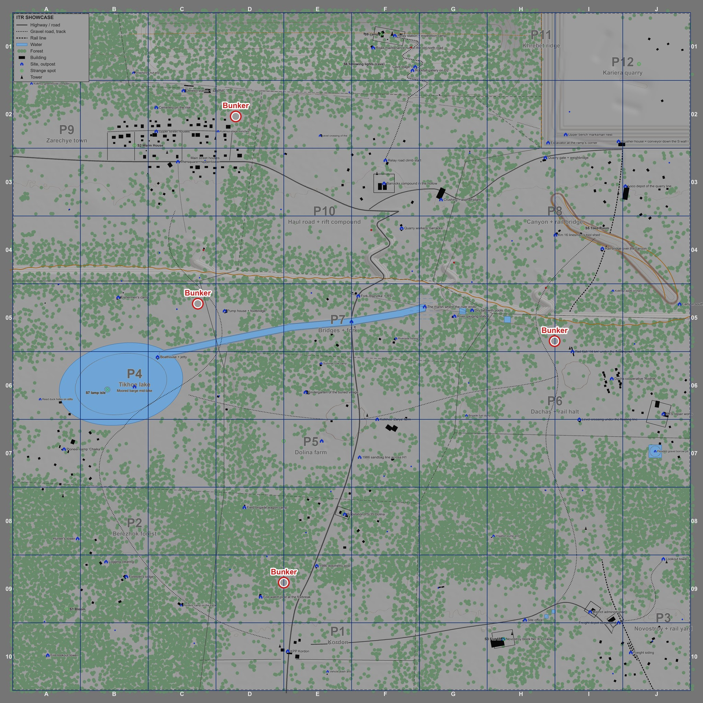

# ITR Showcase

A large custom map for **Into the Radius 1 (version 2.7.2)**, with its Unreal project. It is a reference
building a big ITR maps: how big a 2.7.2 map can be, how the zone look is matched (but not particularly well yet), and how
the game's gameplay systems (loot, spawners, rifts, stashes, anomalies, cover, navmesh, teleports, exits, missions and the
fog perimeter) are set up in a level that the game loads like a stock zone. Open the project to inspect the placements and
copy what you need.

I liken it to falling out a tree and hit every branch on the way down, so that you don't have to.

About 2.5 x 2.5 km playable, with a fog wall so people don't fall out of the world.



*Layout overview, north up, east right, 250 m grid squares (A to J across, 01 to 10 down).* It is the pictured in the game map too! It's a map in the map! And on the hip tablet map! It's just maps all the way down. The playable area is about 2.5 x 2.5 km.*

## Status
**Early test with issues.** It loads and you can walk around it. Entry, the return pad, view distance, loot, spawners, missions,
climbing, the compass and the tablet map have all been tried in VR.
Known issues:
- **Saving in the map works now**, as long as the tags pak (`zzz_ITRMap_ItrShowcase_Tags_P.pak`) is installed with the map pak. Without it you load back into the hub.
- The bunkers are new and have had the least testing.
- Everything placed is still being tuned.
- The fog wall's transition (walk into the fog, get put back inside) has not been tested. I dunno I just can never be bothered.
- My game sometimes crashes when I exit it, but it's done that before I even installed anything so I doubt it's this.

[`itr-common`](../itr-common/) has the map-making how-to, the editor patch and the generic loader this one is based on. It says
how far each thing has been tested.

## What it looks like
[Bill from discord gave it a test and recorded it and shared it with me and I watched it](https://www.youtube.com/watch?v=li1TlzQaiOM) and now I feel like a filthy peasant for the way that I play the game. His approach was very immersive and mine is very mechanical. I also felt bad that he spent so much time checking loot when most of it's all just scattershot at this point.

I have a playlist of all the unlisted progress videos I've been keeping that [demonstrates my aforementioned peasantry](https://www.youtube.com/playlist?list=PLALdXbCjygX0).

## What's in the box
| Folder / file | What |
|---|---|
| `project/` | The Unreal 4.27 project. It has to be called `IntoTheRadius.uproject`. The map is in `Content/Mods/ItrShowcase/`: `L_ItrShowcase.umap` (the level, stored with Git LFS), the landscape layers and material, sky and marker materials, about 240 loot tables (`DataTable`s and composite tables), the mission data assets (`Missions/`) and the generated Blueprints. |
| `project/Plugins/ItrShowcaseEditor` | An optional editor plugin that builds the map's Blueprints (teleport pad, light event, light follower, loot-table holder, the perimeter tide, an event director, a region director, the map settings, compass and progression actors) from JSON specs. You don't need it to open the map or to make your own. |
| `project/build-map.ps1`, `extract-game-config.ps1` | Cook and pack the map into a pak; extract the game's `DefaultEngine.ini`. |
| `loader/` | The UE4SS Lua mod that registers the map with the game, enters it and registers its missions, configured for this map. See [`loader/README.md`](loader/README.md). |
| `docs/images/` | Pictures used in this README. |
| `INSTALL.md` | How to install the release archives (a copy is inside both of them). |
| `CHANGELOG.md` | What changed between releases. |
| `READMEBORING.MD` | Stuff that I moved out of this readme because it was probably boring, but it's also useful technical information. I guess. |

Not in the box:
- **The release archives and the pak.** Those are on the **GitHub releases** page: a normal zip and a FOMOD zip for Vortex. Both
  have the pak, the loader and UE4SS trimmed to the files the loader needs, with its licence.
- **A head**
- **The game's assets.** The map references meshes, materials and textures by their `/Game/...` path and the pak
  contains none of them. The project's copies of those (under `project/Content` outside `Mods/ItrShowcase`) are
  git-ignored. See "Opening the project" in `READMEBORING.MD`.


## Cloning (Git LFS)
`project/Content/Mods/ItrShowcase/L_ItrShowcase.umap` is about 156 MB, over GitHub's file limit, so it is stored with
**Git LFS**. Install [Git LFS](https://git-lfs.com/) before cloning:
```
git lfs install
git clone <this repo>
```
If you cloned without lfs, what are you doing with your life. And the `.umap` is a small text pointer file that needs to be fixed so run `git lfs pull` inside the repo.

## Install and play (from a release)
Download one archive from the **Releases** page:
- `ItrShowcase-<date>.zip`: unzip it into the game folder (the one with `IntoTheRadius.exe`).
- `ItrShowcase-<date>-FOMOD.zip`: install it with Vortex and the "Into the Radius VR" extension.

Both install the same files: the pak in `Content\Paks\~mods`, the loader in `Content\Paks\LuaMods\ItrShowcaseLoader`, and UE4SS
v3.0.1-321-gc62ada0 ("UE4SS for ITR1", Nexus Mods mod 359) in the Nexus layout, where `override.txt` points UE4SS at
`Content\Paks`. If you already run UE4SS, leave its files out (the FOMOD installer has a tick box for that). Other UE4SS builds
are not known to work; a newer dev build crashed the game at startup for me.

Then continue into the Hub and enter the map in one of three ways:
1. pick up the **tin of graphite grease** in the Hub's workshop corner, by the tool wall and workbench: a grey metal tin with a
   yellow lid and a "GRAPHITE GREASE 500g" label (the loader looks for its static mesh, `Liquid08_1`). There's a second tin and a
   loose lid next to it that do nothing, so if the first tin does nothing, try the other one,
2. press **F9**,
3. run the console command `itrshowcase enter` (the release doesn't add a console; use one you have, or a mod that sends console
   commands).

 To leave, walk onto the **return pad** (R0, at the Kordon entrance), or press `F9`, or type `itrshowcase leave`. The bunkers can also be used, see "Bunkers" below. The settings, the exact paths, what is left out of UE4SS, troubleshooting and uninstalling are in [`INSTALL.md`](INSTALL.md).


## Showcase missions and uninstalling
With the map installed, the mission computer offers a series of twelve "showcase" missions, separate from the main story (no story
conditions, and finishing one does not set a story flag). They come one at a time and each one only once. Eight more go into the
stock random mission pool. They are cooked data assets in the map pak (`Content/Mods/ItrShowcase/Missions/`). The loader adds them to
the game's mission configuration at startup, and the objective points to the map-point configuration
(`loader/ItrShowcaseLoader/Scripts/missions.lua`, `ItrShowcase.missions.json`).

When the map loads it unlocks level progression in your save: player level 5, the stock zones marked as visited, and the stock
shortcut and transition flags set. That stays after you uninstall.

Before you uninstall, if you have an in progress mission, finish or abort the accepted showcase ones at the
mission computer and copy the save first. I don't know what happens to an orphaned mission.
To keep the map but turn the missions off, set `Missions = { Enabled = false }` in `config.lua`. The same warning applies if your
save already has one.

## Bunkers
There are ruined buildings in Kordon, on the track by Tikhoe lake, at the rail halt by the dachas, and at the end of Zarechye's upper street, and their cellar stairs all lead to the same bunker.

Inside there's a bed, a shop, a health booth, storage, a mission computer and a vise.

Walk back to the landing to get back out. The tunnel door's handle can be grabbed to return to the Hub. When you want to return, you'll return back to wherever you left from.

The sun and sky light are off while you're inside, because the forward renderer can't block a movable sky light with walls.

Known issues with the bunkers:
- The fade is a bit heavy handed and will be tuned.
- If you save standing on a landing, you go through the fade when it loads.
- Loose items on the landing stay behind when you go through.
- The bunker is outside the map square, so the tablet map shows you off the picture while you're in it. The ruin on top of it may be visible from the edge of the map.

## It's an example, or a demo, I call it showcase
Everything is placed in `L_ItrShowcase` (the persistent level of the map) and grouped in the World Outliner by
pocket: `P1_Kordon/...` to `P12_Kariera/...`, plus `Returns/R0`, `Teleports`, `Rail`, `Water` and `Network`. The systems and
their counts are in `READMEBORING.MD`.


## Attribution
Five of the map's sites (the checkpoint, construction yard, farm, station and quarry) are laid out 1:1 from OpenStreetMap
data, and the village street patterns are measured from other villages. Contains data (c) OpenStreetMap contributors,
available under the Open Database Licence (ODbL) 1.0: https://www.openstreetmap.org/copyright.


## Obligatory AI Usage info
AI writes code about 10x quicker than me and it is often less frustrating than banging my head against why unreal editor wont build for hours on end(only to learn I didn't need *that* component to build anyway) and then needing to learn the ins and outs of shaders to make code edits to generate the right format used by the original game.... So in this case it made a lot happen that wouldn't have happened otherwise and the caveat that that comes with is that the 'owner' of the code in this instance(and probably most instances imho) does not have the depth of knowledge that you'd want. But this is just a basic map I manufactured to try show things like how "big" works, how spawners work, how loot can work etc. So it's better to have than not to I hope.

Also the documentation... writing documentation for a repo no one will ever see is unmotivating and so without ai usage it's unlikely to have materialized.

### For example
- I got ai to write python to convert my crappy mspaint height map into a proper heightmap and then import into unreal editor.
- I got ai to write python that smooths it and adds noise so it's not all just flat plains.
- I got ai to write python that read another mspaint picture so that it built roads. And then more python that means a road isn't just flat "road thing" and instead curves and has slight elevation and ditches on the side. Similar for rail
- I got ai to write python that read enemy and loot densities from the game and then mirror those to tiers, and then apply those tiers to regions on the map.
- I got ai to write python that reads my mspaint of forests and tree density and then add it to unreal editor.
- I got ai to write the python that turned layouts from online building maps into json files.
- I got ai to write the python that export typical building contents from ITR to use as building blocks in the map.
- I got ai to write the python that imported those into the map at the appropriate points with the correct altitude and in layouts matching the town/are definitions.
- I got ai to write the python that builds enemy cover points based on placed objects, because they need shoot from cover map positions.
- I got ai to come up with the area/theme appropriate names because I'd just call things "town 1" and "small town 1".
- I got ai write the python that creates the ingame map from my data....
- and so on and so on and so on.

It would take me months or to write all the code that has been used to generate this, and even then my code would be rushed, buggy and probably slow, with less unit tests.

Any quality issues with the map(of which there are many) are either human jank, or a product of it being a large amount of work.


## Credits:
- **Into the Radius** is by CM Games; all game assets belong to them.
- **ITR-SDK** by ChuckSharts, and the other community SDK copies: the gameplay Blueprints and module declarations this
  project builds on.
- **UE4SS**, and the "UE4SS for ITR1" repack on Nexus Mods by MerithXYZ.
- **OpenStreetMap contributors** because I used some stats from regional building layouts to drive my layouts.