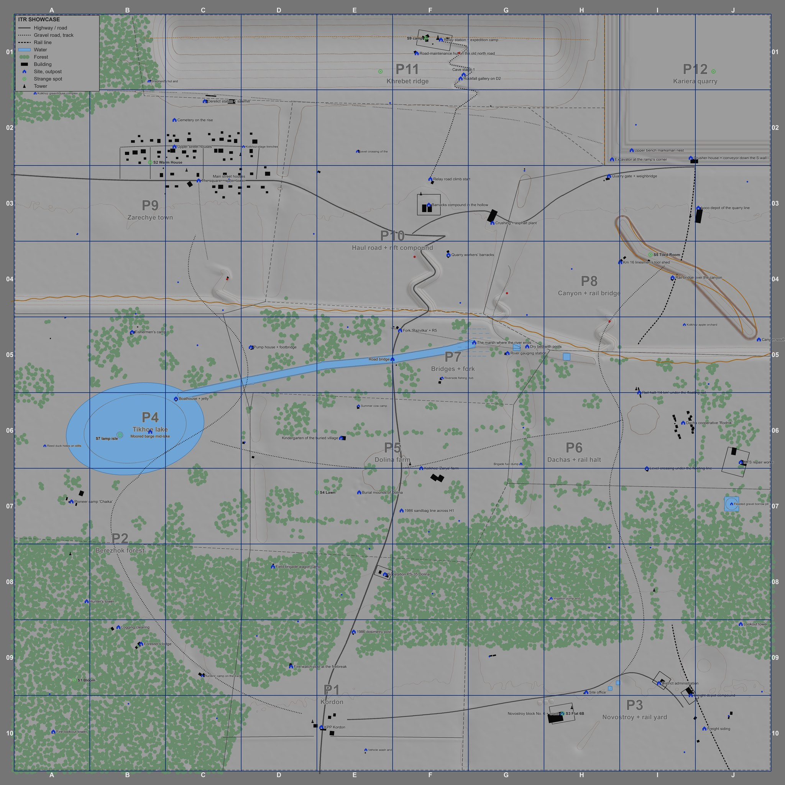

# ITR Showcase

A large custom map for **Into the Radius 1 (version 2.7.2)**, with its Unreal project. It is a reference for people
building their own maps: how big a 2.7.2 map can be, how the zone look is matched (but not particularly well yet), and how
the game's gameplay systems (loot, spawners, rifts, stashes, anomalies, cover, navmesh, teleports, exits, missions and the
fog perimeter) are set up in a level that the game loads like a stock zone. Open the project to inspect the placements and
copy what you need.

About 2.5 x 2.5 km playable, inside a fog wall, built from 2.7.2 assets only.



*Layout overview, north up, east right, 250 m grid squares (A to J across, 01 to 10 down). It is the picture on the map board
at the entrance and on the hip tablet in the map. The playable area is about 2.5 x 2.5 km.*

## Status
**Early test with issues.** The map loads through the game's level transfer, can be walked, and has been through
in-game runs in VR (entry, return pads, view distance, loot, spawners, missions, climbing, the compass and the tablet map).
A full pass in VR is still to come. Known issues:
- **A save made inside the map loads into the Hub**, not into the map. The loader registers the level before the main menu
  and turns the level's save flags on; the cause is not found yet.
- **Sun and sky light intensity are not applied yet.** The intended default for both is 1.0, the level in the pak still
  carries 3.0.
- Layout and dressing are still being tuned from walk tests: ground and foliage colour, enemy pressure, and where stashes
  and rifts sit.
- The fog wall's transition (walk into the fog, get put back inside) has not been through a full VR test since native loading.
- Loot balance is still being tuned.
- The game can crash while it shuts down. The same crash is in sessions without any mod installed, so it is not caused by
  this map or the loader.

The sister repo [`itr-common`](../itr-common/) has the map-making how-to, the editor patch and the generic loader this one is
based on, and says for each thing how far it has been tested.

## What's in the repo
| Folder / file | What |
|---|---|
| `project/` | The Unreal 4.27 project. It has to be called `IntoTheRadius.uproject`. The map is in `Content/Mods/ItrShowcase/`: `L_ItrShowcase.umap` (the level, stored with Git LFS), the landscape layers and material, sky and marker materials, about 70 loot `DataTable`s, the mission data assets (`Missions/`) and the generated Blueprints. |
| `project/Plugins/ItrShowcaseEditor` | An optional editor plugin that builds the map's Blueprints (teleport pad, light event, light follower, loot-table holder, the perimeter tide, an event director, the map settings, compass and progression actors) from JSON specs. You don't need it to open the map or to make your own. |
| `project/build-map.ps1`, `extract-game-config.ps1` | Cook and pack the map into a pak; extract the game's `DefaultEngine.ini`. |
| `loader/` | The UE4SS Lua mod that registers the map with the game, enters it and registers its missions, configured for this map. See [`loader/README.md`](loader/README.md). |
| `docs/images/` | Pictures used in this README. |
| `INSTALL.md` | How to install the release archives (a copy is inside both of them). |
| `CHANGELOG.md` | What changed between releases. |

Not in the repo:
- **The release archives and the pak.** They are **GitHub release** assets: a normal zip that unzips into the game folder, and
  a FOMOD zip for Vortex. Both contain the pak, the loader and UE4SS trimmed to the files the loader needs, with its licence.
- **The game's assets.** The map references meshes, materials and textures by their `/Game/...` path and the pak
  contains none of them. The project's copies of those (under `project/Content` outside `Mods/ItrShowcase`) are
  git-ignored. See "Opening the project".

## Cloning (Git LFS)
`project/Content/Mods/ItrShowcase/L_ItrShowcase.umap` is about 156 MB, over GitHub's file limit, so it is stored with
**Git LFS**. Install [Git LFS](https://git-lfs.com/) before cloning:
```
git lfs install
git clone <this repo>
```
If you cloned without it, the `.umap` is a small text pointer file; run `git lfs pull` inside the repo.

## Install and play (from a release)
Download one archive from the **Releases** page:
- `ItrShowcase-<date>.zip`: unzip it into the game folder (the one with `IntoTheRadius.exe`).
- `ItrShowcase-<date>-FOMOD.zip`: install it with Vortex and the "Into the Radius VR" extension.

Both install the same files: the pak in `Content\Paks\~mods`, the loader in `Content\Paks\LuaMods\ItrShowcaseLoader`, and UE4SS
v3.0.1-321-gc62ada0 ("UE4SS for ITR1", Nexus Mods mod 359) in the Nexus layout, where `override.txt` points UE4SS at
`Content\Paks`. If you already run UE4SS, leave its files out (the FOMOD installer has a tick box for that). Other UE4SS builds
are not known to work; a newer dev build crashed the game at startup in our tests.

Then continue into the Hub and enter the map in one of three ways:
1. pick up the **tin of graphite grease** in the Hub's workshop corner, by the tool wall and workbench: a grey metal tin with a
   yellow lid and a "GRAPHITE GREASE 500g" label (the loader recognises it by its static mesh, `Liquid08_1`). It stands with a second
   tin and a loose lid, which do nothing; if the first tin you pick up does nothing, try its neighbour,
2. press **F9**,
3. run the console command `itrshowcase enter` (the release does not add a console; use one you have, or a mod that sends console
   commands).

The game's normal transition takes you to the start in the south. To leave, walk onto one of the **return pads** (R0 to R6), or
press `F9`, or type `itrshowcase leave`. The settings, the exact paths, what is left out of UE4SS, troubleshooting and
uninstalling are in [`INSTALL.md`](INSTALL.md).

If you also have `ITRMapLoader` (the example map loader from `itr-common`) installed, switch it off while you play the showcase;
`INSTALL.md` says how.

## Showcase missions and uninstalling
With the map installed, the mission computer offers a "showcase" mission series of twelve missions, separate from the main story
(no story conditions, and finishing one does not set a story flag). They come one after the other, each mission once: a finished
mission is not offered again and brings up the next one. Eight more showcase missions are added to the stock random mission pool.
The missions are cooked data assets in the map pak (`Content/Mods/ItrShowcase/Missions/`); the loader appends them to the game's mission
configuration at startup and adds the objective points to the map-point configuration (`loader/ItrShowcaseLoader/Scripts/missions.lua`,
`ItrShowcase.missions.json`). When the map loads, level progression is unlocked in your save: player level 5, the stock zones marked as
visited, and the stock shortcut and transition flags set. That unlock is written into the save and stays after you uninstall.

Before you uninstall with a save that holds a showcase mission (offered, accepted or finished), finish or abort the accepted ones at the
mission computer and copy the save first. What the game does with a saved mission whose data asset is gone has not been tested: it may
skip it or report an error. Missions of the main story are not affected. To keep the map but turn the missions off, set
`Missions = { Enabled = false }` in `config.lua`; that stops the loader registering them, so the same warning applies to a save that
already holds one.

## What the map demonstrates
Everything below is placed in `L_ItrShowcase` (the persistent level of the map) and grouped in the World Outliner by
pocket: `P1_Kordon/...` to `P12_Kariera/...`, plus `Returns/R0` to `Returns/R6`, `Teleports`, `Rail`, `Water` and `Network`. The numbers
are from the cooked level of the current build (counts of placed actors and instances); the outliner has the real ones.

### Scale and layout
- One landscape of 2521 x 2521 vertices (about 2.5 km) with a separate material (`M_ItrShowcase_Landscape`: eight
  weight-blended layers using 2.7.2 ground textures, `LI_ItrShowcase_*`). There is no backdrop landscape: a fog wall
  closes the map (see "The edge of the map").
- Twelve pockets (P1 to P12), each with a tier from T1 to T5 that sets its enemy roster and loot, difficulty rising from south to
  north: P1 Kordon, the entrance checkpoint on the south rim (T1); P2 Berezhok forest (T2); P3 Novostroy construction site and rail
  yard (T2); P4 Tikhoe lake with a boathouse and a lamp isle (T3); P5 Dolina farm (T2); P6 dachas and a rail halt (T3); P7 bridges and
  a fork on the valley floor (T3); P8 canyon and rail bridge (T4); P9 Zarechye town (T4); P10 haul road and a rift compound (T4); P11
  Khrebet ridge with a relay mast, an expedition camp and a cave network (T5); P12 Kariera quarry (T5). Roads, rail, a river and the
  lake link them.
- About 22,000 static-mesh actors, about 1,700 gameplay actors, and about 140,000 foliage and merged-mesh instances in HISM
  groups.
- Placed at world (-34500, -364000, 0) cm. The map is registered as its own level, so the Hub's level radius does not apply;
  the loader gives it a radius of 2.5 km around that point.

### Zone look
Sun, sky light (the game's cubemap `04-03_Sun_A_1024`), height fog and an unbound post-process volume, following the
2.7.2 Buffer zone's setup; the sky sphere is the game's mesh and master material with material instances made for the map
(`MI_ItrShowcase_Sky_*`), and the Radius ball sits in the north. Sun and sky light intensity are still 3.0 in the pak
(intended 1.0, see Status). Landscape grass uses copies of the game's grass types with longer cull distances
(`Content/Mods/ItrShowcase/Grass`).

### The edge of the map
The map ends in a square fog wall about 1.25 km from the centre, so there is no backdrop to build or load. The pieces:
- `BP_ItrShowcase_PerimeterTide` (`Content/Mods/ItrShowcase/Blueprints`): a child of the game's `BP_TideBase`. It tests the player
  against a square (about 1247 m from the centre) every 0.1 s instead of the stock circle and then calls the stock `DoTransition`:
  the player is moved to one of the respawn points and the level is re-entered through the game's transition.
- Seven `BP_SpawnSpline` actors inside the nav volumes are the respawn points (`PlayerSpawn`).
- Twelve `FogWall_*` plane actors (four sides, three layers: fog, masked fog and an opaque backstop) with the game's fog materials
  (`FogMaterial_Inst`, `MI_FogMaterial_Masked`), up to 180 m high.
- The backdrop landscape and the trees and foliage past the edge of the main landscape were removed, so nothing outside the wall
  is built or loaded.

### Gameplay systems
All of these are the game's Blueprints (`/Game/ITR/BPs/...`) with per-instance property overrides. Open the level and
select one to see how it is configured.

| System | Class | Where | How it's set up |
|---|---|---|---|
| Enemy squads | `BP_MonsterSpawner` (about 600, roaming and static together) | `<Pocket>/Gameplay/Spawners` | `Monsters` is a map of NPC tag to count (for example `NPC.Monster.Mimic.PM`: 1, `NPC.Monster.Fragment`: 2), `Radius` is the spawn scatter (roughly 10 to 55 m for roaming squads), `AlternativeMonstersMax` 1 to 4, `CanWalkAway`, `SnipingMode` for marksmen. Each has a stable `SpawnerInstanceID` of the form `L_ItrShowcase>P1_P1_KPP_E1_b0`, which is the key the game's save uses. The roster gets harder from tier 1 (Spider, Fragment, Mimic PM) through Seekers and armed Mimics (sawn-off shotgun, MP5, SVD) to armoured Seekers, Fragments and Mimics (AKSu, AKM, Val) and a few Sliders in tiers 4 and 5. |
| Static NPCs | the same `BP_MonsterSpawner` | `<Pocket>/Gameplay/Static` | One monster, `CanWalkAway` off, a `Radius` of a few metres at most, so the NPC stands where you placed it: guards, a man in an attic. Snipers also set `SnipingMode`. |
| Rifts | `BP_MonsterSpawnGenerator` (12) | `<Pocket>/Gameplay/Rifts` | The visible, shootable source of enemies. `generatorID` is a custom tag (`NPC.Generator.ItrShowcase.A0_1`), `Spawners` lists the spawners it drives, `CooldownSeconds` 150. The tags are registered in the project's gameplay tags. |
| Loot | `BP_RandomLoot` (about 500) | `<Pocket>/Gameplay/Loot` | `LootTable` is a custom tag (`Loot.ItrShowcase.T1.Ammo`), `LootPoints` is the node's share of the tag's budget, `InstanceID`/`InstanceIDPrefix` are set so the save can key them. Tags are per tier and category: Ammo, Equipment, FoodBaseItem, plus stashes. |
| Artifacts | `BP_RandomLoot` (about 190 of the 500, one point each) | `<Pocket>/Gameplay/Artifacts` | Loot nodes next to the anomalies, on the per-tier `Loot.ItrShowcase.<tier>.Artifact` tags. |
| Stashes and corpses | `BP_Stash_Small`, `BP_Stash_Large` (about 330 together), `BP_Corpse` (2) | `<Pocket>/Gameplay/Stashes` | Same `LootTable` mechanism with the `Stash.Red`, `Stash.Grey`, `Stash.Valuables` and `Stash.Deadmans` tags, plus ten signature stashes. Stashes are placed out of sight rather than in the open. |
| Anomalies | `BP_Anomaly_Gas`, `_Grass`, `_Web`, `_Distortion`, `_Lightning` (about 270) | `<Pocket>/Gameplay/Anomalies` | One actor each, no property overrides. The game's anomaly clusters are driven by map-point data registered per level, so as far as we know they don't work in a custom map; this map uses single anomalies. |
| Mission points | `BP_ItrShowcase_MissionPoint` (20) | the pockets | Objective points of the showcase missions. The loader registers each point's tag and position with the game's map-point configuration. |
| AI cover | `ItrShowcase_CoverLoader`, a child of the game's `ACoverLoader` (`Content/Mods/ItrShowcase/Blueprints/BP_ItrShowcase_CoverLoader`) | persistent level | One actor holding the cover and shooting-position arrays (plain world-space `FVector`s, the same data the zone levels carry) with the zone's `CoverSettings`. |
| Navmesh | `NavMeshBoundsVolume` (12) | `Nav` | Volumes around the gameplay footprints, not the whole map, baked for the game's two agents (Default and Big). |
| Teleports | `TargetPoint`s tagged `itr:tp:<group>/<name>` | `Teleports/<group>` | Standing-height points on walkable ground (dry, not on a steep slope). The game ignores the tag; it is a label that tools such as a teleport menu can list. |
| Exits and arrivals | `TargetPoint`s tagged `itr:player_start`, `itr:exit` + `itr:exit_id:R<n>`, `itr:arrive:R<n>` | `Returns/R0` to `Returns/R6` | Read by the loader. Walking onto an exit marker takes you back to the Hub; the next entry puts you at the matching arrive marker. R0 is the entrance at P1; R6 is at the lake (P4). |
| Return pads | a flat disc and a light beam (static meshes) | `Returns/R<n>` | The visible part of each exit: stand on the pad and the loader's exit marker on it sends you to the Hub. |
| To-entrance pads | `BP_ItrShowcase_TeleportPad` | `Returns/R<n>` | An engine-only Blueprint (no game classes) beside R1 to R6 that teleports you inside the map, back to the R0 start area. |
| Fog perimeter | `BP_ItrShowcase_PerimeterTide`, `BP_SpawnSpline`, `FogWall_*` | `Global/Perimeter` | See "The edge of the map". |
| Map board and tablet map | a two-sided map sign (a `StaticMeshActor` tagged `itr:mapboard`) carrying the material instance `MI_ItrShowcase_Map` | at the entrance | The picture on the sign is also what the hip tablet shows while you are in the map: the loader points the map's level row at the sign's material, and adds one `LevelGates` row per return pad so the pads show as markers. |
| Runtime settings | `BP_ItrShowcase_MapSettings`, `BP_ItrShowcase_CompassSky`, `BP_ItrShowcase_Progression` | persistent level | Blueprint actors that do what a loader would otherwise do every tick: `MapSettings` sets `r.ViewDistanceScale 5` and `foliage.LODDistanceScale 5` in BeginPlay and restores the earlier values in EndPlay, `CompassSky` sets the compass target, `Progression` sets the player level and the trigger flags of the progression unlock. |

### Loot setup
This is the part most map makers will want to copy.
```
Quick interjection since most of this document was with ai and it's made a heck of a claim right there!
It's a bit strong to say 'map makers will want to copy', since the loot on this is map a little different and it's not just "here is loot table". So
a) folks might find this a little overcomplicated for what *they* want, although it does simplify down
b) once some maps are made, circulated and played, a better approach may be adopted.
So it's a tad overconfident to say 'map makers will want to copy' and then not call out clearly why the loot in the map is pretty cool imho.
- you get to define your loot table(s)
- you can also have different loot tables(tiers) assigned to different spawners and each tier has their own budget.
It's not mind blowing, but it's something I haven't seen done in ITR yet.
```
- The game's loot budgets are global and save-wide per tag, so a 2.5 km map reusing the vanilla zone tags would be sparse.
  The map therefore has **68 custom loot tags** (`Loot.ItrShowcase.<tier>.<category>`): five tiers T1 to T5 (getting better to
  the north, one per pocket tier), each with a budget scaled from the vanilla zone it is modelled on by area, plus ten signature
  stash tags and a small example set (`G2`). The manifest also lists an intermediate tier `T25` that the current layout does not
  use. The manifest is `loader/ItrShowcaseLoader/Scripts/ItrShowcase.loot.json`; it records the tag, the donor tag, the table and
  the budget.
- Each tag has a `DataTable` (`Content/Mods/ItrShowcase/Loot/DT_Loot_ItrShowcase_*`), with rows cloned from the donor
  zone's table, so used loot points are not shared with the vanilla zones.
- Nothing in the map registers these tags with the game, so the loader does it at startup: it adds each tag to the game
  config's `LootArray` (`TMap` of tag to `FPRLootTableConfig`) on the stock donor tables, which never unload. See "Loot" in
  [`itr-common`'s loader README](../itr-common/loader-ue4ss/README.md).
- The map's tables must stay loaded while you are in it, or the game reads a freed table. `BP_ItrShowcase_LootTables` is a
  placed actor whose `Tables` array holds a hard reference to every ItrShowcase table, so they load and unload with the level. Once
  the level is loaded the loader points the entries at those tables, and back at the donor tables when the level goes.
- Generator ids follow the same idea: `NPC.Generator.ItrShowcase.<area>_<n>` (the area part is `A0` to `A9`, a numbering the
  generator still uses for the rifts).

### Native level loading
The loader registers the map with the game as a level, `Level.Zone.ItrShowcase`, and enters it with the game's level
transfer (`TransferToLevel`), so the transition, the unload of the Hub, the prepare and start events, the loot pass and the arrival
run as they do for a stock zone. What it does, at startup, before the main menu:
- adds a streaming entry for `L_ItrShowcase` (`LevelStreaming::CreateInstance`) and a level row to the system config's
  `LevelConfigurations`, copied from the Buffer zone (time, inventory, sleep, saves, map scale; radius 2.5 km);
- adds the map centre and one level-gate row per return pad to the map-point config, and registers the loot tags (above);
- once the game is idle, registers the showcase missions (see "Showcase missions and uninstalling").

Entering and leaving are triggers on top of that (`loader/ItrShowcaseLoader/Scripts/config.lua`): the tin of graphite grease, `F9`, the
console command, the exit markers. Details: [`loader/README.md`](loader/README.md) and the loader README in `itr-common`.

## Opening the project
You can open `project/IntoTheRadius.uproject` to inspect the level, the Blueprints and the placements. What that needs:
- **Engine.** Unreal 4.27. We only opened it with the **patched Oculus 4.27 editor** from `itr-common` (route B in its
  [guide](../itr-common/map-making/guide.md)), which the landscape material needs. A stock editor is untested.
- **It is a code project.** `project/Source/IntoTheRadius` is a recreation of the game's C++ module, generated from
  the game's reflection data by a script in the maintainer's workspace (not in this repo) and verified against the game (classes,
  properties, functions, flags, native defaults; function bodies are empty). Copy the community SDK's `VRExpansionPlugin`
  and `ModFramework` plugins into `project/Plugins/`. Compile it the first time you open the project (Visual Studio with
  the C++ game workload).
  The game's real module is in the game; none of this goes into the pak. The editor plugin,
  `Plugins/ItrShowcaseEditor` (builds the map's Blueprints from JSON specs), is included and optional.
- **Game config.** `Config/DefaultEngine.ini` is the game's file and is not in the repo. Extract it once:
  `project\extract-game-config.ps1 -Engine "<your editor>\Engine"`.
- **Gameplay tags.** The placed Blueprints store tags (`Loot.*`, `NPC.Monster.*`, `NPC.Generator.*`). The editor clears a
  tag value it doesn't know, so the game's tag lists need to be in `Config/DefaultGameplayTags.ini` and `Config/Tags/`
  (they come from the SDK's `Config`). The map's tags are in `Config/Tags/ItrShowcaseGameplayTags.ini`.
- **The game's assets.** The level references the game's meshes, materials, textures and Blueprints by path. Without the
  community **ITR-SDK** (ChuckSharts, see the itr-common guide §1) copied into `project/Content` at the same `/Game` paths,
  those references are missing and the level opens with empty slots. Take the gameplay Blueprints from ChuckSharts's SDK,
  not R3mains's. The SDK's master materials are reconstructions: reference them, don't cook copies of them.
  A handful of the meshes (the tower-crane kit and some others) are in no SDK at all.
- **Cook and pack** (only if you want to make a pak from a modified level):
  `project\build-map.ps1 -Engine "<your editor>\Engine"` cooks `/Game/Mods/ItrShowcase/L_ItrShowcase` and packs only
  `/Game/Mods/ItrShowcase` into `zzz_ITRMap_ItrShowcase_P.pak`, so none of the copied game assets end up in it. Landscape
  grass data is baked in the editor and has to be baked before cooking, or the grass is missing from the pak.

The levels were generated by scripts and then baked (navmesh, grass), not authored by hand in the editor. The result is a
normal level you can edit.

## Attribution
Five of the map's sites (the checkpoint, construction yard, farm, station and quarry) are laid out 1:1 from OpenStreetMap
data, and the village street patterns are measured from other villages. Contains data (c) OpenStreetMap contributors,
available under the Open Database Licence (ODbL) 1.0: https://www.openstreetmap.org/copyright.

## Licence and credits
The licence of this repo is not settled yet. Expect the same as `itr-common`: AGPL-3.0 for the scripts, with the Unreal
Engine EULA applying to any cooked pak. The map is made of the game's assets, referenced by path; they are not
redistributed. The release archives include UE4SS, which is MIT-licensed; its licence text is in the archives
(`UE4SS-LICENSE.txt`).

Credits:
- **Into the Radius** is by CM Games; all game assets belong to them.
- **ITR-SDK** by ChuckSharts, and the other community SDK copies: the gameplay Blueprints and module declarations this
  project builds on.
- **UE4SS**, and the "UE4SS for ITR1" repack on Nexus Mods by MerithXYZ.
- **OpenStreetMap contributors** because I used some stats from regional building layouts to drive my layouts.

## Obligatory AI Usage info
AI writes code about 10x quicker than me and it is often less frustrating than banging my head against why unreal editor wont build for hours on end(only to learn I didn't need *that* component to build anyway) and then needing to learn the ins and outs of shaders to make code edits to generate the right format used by the original game.... So in this case it made a lot happen that wouldn't have happened otherwise and the caveat that that comes with is that the 'owner' of the code in this instance(and probably most instances imho) does not have the depth of knowledge that you'd want. But this is just a basic map I manufactured to try show things like how "big" works, how spawners work, how loot can work etc. So it's better to have than not to I hope.

Also the documentation... writing documentation for a repo no one will ever see is unmotivating and so without ai usage it's unlikely to have materialized.